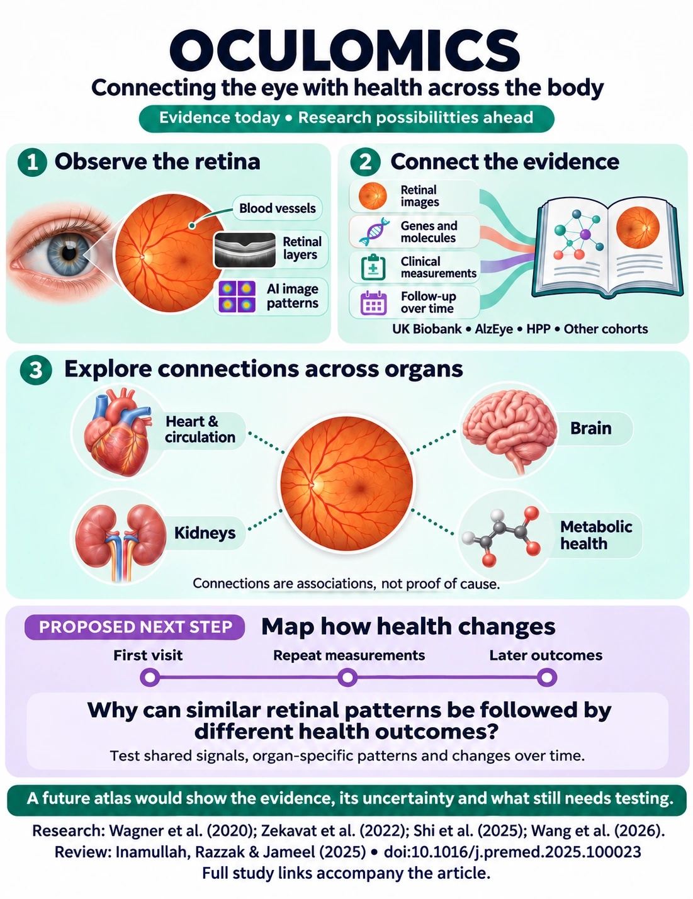

Imagine two people whose retinal images show similar vascular changes. Over the following decade, one develops heart failure, while the other develops kidney disease. A future research programme could investigate what distinguishes these trajectories—and whether molecular measurements, genetics and repeated imaging help explain that difference.

This is a possible next direction for **retinal systems biology**: connecting retinal observations with biological processes and the development of disease across organs.

<a href="#infographic">Explore the infographic</a> · <a href="#references">Read the ten study references</a>

<figure id="infographic" style="margin:2rem 0;scroll-margin-top:2rem">
  
  <figcaption style="font-size:0.85em;line-height:1.6;margin-top:0.8rem">A conceptual overview of retinal systems biology. Dotted connections represent associations under investigation. The proposed atlas and future research questions are distinguished from established study findings. <a href="/images/oculomics-eye-body-atlas-2026.webp">Open the infographic at full size</a>.</figcaption>
</figure>

## The foundations span ophthalmology, cardiology, population science and artificial intelligence

Siegfried Wagner and colleagues introduced the term *oculomics* in their 2020 paper, *Insights into Systemic Disease through Retinal Imaging-Based Oculomics*. They described the use of ocular measurements to investigate systemic health, bringing cardiovascular and neurodegenerative disease into a common research framework [1](#reference-1).

Wagner’s subsequent work includes AlzEye, which links ophthalmic records with hospital admissions across a large clinical population. Its collaborators include Pearse Keane, Alastair Denniston and Eric Topol, illustrating the connections between ophthalmology, cardiovascular medicine and computational research [2](#reference-2).

UK Biobank has provided another major foundation. Research by Seyedeh Maryam Zekavat, Pradeep Natarajan and colleagues examined retinal vascular measurements in more than 54,000 participants, identifying associations with subsequent cardiovascular, renal and metabolic conditions alongside genetic associations [3](#reference-3). A later study involving Nazlee Zebardast and collaborators connected OCT-derived retinal layers with systemic phenotypes and genetic variation in approximately 45,000 participants [4](#reference-4).

These findings motivate a systems question: **how much of a retinal signal reflects biological processes shared across diseases, and how much carries information about a particular organ?**

## Foundation models offer ways to connect different observations

CLIP demonstrated how images and text could be represented together by learning their correspondence [5](#reference-5). EyeCLIP adapted related principles to ophthalmology, combining image reconstruction with alignment between ophthalmic examinations and clinical text [6](#reference-6).

A future retinal atlas could extend this approach to images, quantitative vascular measurements, retinal layers, circulating molecules and clinical outcomes. The challenge would be to preserve meaningful differences between these measurements while learning their relationships.

Deep phenotyping studies such as the Human Phenotype Project offer complementary molecular, physiological and lifestyle information [7](#reference-7). Their contribution would sit alongside UK Biobank, clinical resources such as AlzEye, and independent international cohorts. An atlas would need to preserve the differences between these populations and their available measurements.

Temporal modelling is also advancing. RETFound Plus incorporates information from repeated retinal images to study subsequent disease outcomes [8](#reference-8). RetiME investigates retinal representations associated with mortality risk and modelled lifespan trajectories [9](#reference-9). A future contribution must therefore advance beyond the general idea of predicting later disease from retinal images.

## The wider literature provides a roadmap for this transition

The survey *The eye as a window to systemic health: A survey of retinal imaging from classical techniques to oculomics* places these developments within a broader research agenda. It discusses the transition from conventional retinal analysis towards integrating imaging, molecular information and clinical evidence, alongside priorities for longitudinal research, foundation models and explainability [10](#reference-10).

Building on these priorities, a retinal systems biology atlas could investigate how imaging features relate to molecular variation and subsequent disease across organs. The survey provides conceptual motivation, while individual cohort studies provide empirical evidence. The proposed atlas would connect these strands while preserving the distinction between observed associations, predictive relationships and biological hypotheses.

## A promising research direction is to investigate how disease trajectories diverge

A proposed atlas could distinguish shared systemic vulnerability from information associated with particular organ outcomes. It could then examine whether molecular and clinical measurements help explain why people with similar retinal patterns follow different courses.

| Proposed research question | Evidence needed |
|---|---|
| Do retinal vascular patterns reflect vulnerability shared across the heart, kidneys and brain? | Reproducible associations across outcomes and populations after appropriate adjustment. |
| Which measurements distinguish future organ outcomes? | Added information from molecular profiles, organ measurements or genetics beyond retinal and clinical predictors. |
| Does retinal change track changing systemic health? | Relationships supported by repeated measurements within individuals. |
| Can disagreement between retinal and systemic measurements be informative? | Reproducible differences that improve prediction or identify meaningful subgroups. |

These are hypotheses to investigate. Their contribution would depend on what the data demonstrate.

## Disagreement between measurements could be particularly informative

Consider a person with relatively preserved retinal structure but adverse metabolic measurements, or someone with pronounced retinal changes despite comparatively favourable routine blood results.

These differences could motivate research into biological resilience, early injury or variation between organ systems. They could also arise from measurement error, treatment, ocular disease or incomplete clinical information.

A study could test whether this disagreement adds information beyond each measurement considered separately. Comparisons with established clinical predictors and validation in independent populations would help determine whether the pattern has practical value.

## An atlas would need to represent time explicitly

A single examination provides a snapshot. Baseline imaging linked to later diagnoses can support risk prediction, while repeated imaging can help characterise changes within a person. A modelled trajectory should be identified as an estimate and assessed against observed follow-up.

A proposed atlas could model transitions between defined health states—for example, from no recorded disease to a first cardiovascular event and subsequently to additional morbidity. Different sequences and competing outcomes would need to be accommodated.

Measurements from the same participant and visit would support direct alignment. Changes between visits would need to remain visible to the model. External tissue and cell atlases could supply biological annotations, clearly distinguished from measurements actually collected in that participant.

## Biological interpretation would require evidence beyond a convincing visualisation

Retinal representations could be examined alongside measurable features such as vascular density, branching complexity and retinal layer thickness. Associations with proteins, metabolites or genetic variation could help prioritise candidate biological explanations.

A pathway annotation would remain supporting context. A statistical relationship would remain an association unless the study design justified a stronger interpretation. Longitudinal evidence, genetic analyses and intervention studies could contribute different forms of evidence.

The atlas could make those distinctions visible: what was measured, which population supplied the evidence, whether a relationship replicated, and whether it concerns current disease, future risk or observed change.

## The decisive test would be whether integration produces useful, reproducible knowledge

A strong study would compare the proposed approach with clinical predictors, retinal measurements alone and existing multimodal models. It would assess performance and calibration across populations, imaging systems and healthcare settings, alongside the stability of the inferred biological relationships.

The resulting contribution could be an atlas that identifies shared systemic signals, distinguishes trajectories towards different organ diseases, and exposes the evidence behind each connection. That would give retinal systems biology a concrete objective: understanding which aspects of health the retina reflects, under what conditions, and how those relationships evolve over time.

## References

1. **Wagner SK, et al. (2020).** [Insights into Systemic Disease through Retinal Imaging-Based Oculomics](https://doi.org/10.1167/tvst.9.2.6). *Translational Vision Science & Technology*, 9(2), 6.
2. **Wagner SK, et al. (2022).** [AlzEye: longitudinal record-level linkage of ophthalmic imaging and hospital admissions of 353,157 patients in London, UK](https://doi.org/10.1136/bmjopen-2021-058552). *BMJ Open*, 12, e058552.
3. **Zekavat SM, et al. (2022).** [Deep Learning of the Retina Enables Phenome- and Genome-Wide Analyses of the Microvasculature](https://doi.org/10.1161/CIRCULATIONAHA.121.057709). *Circulation*, 145(2), 134–150.
4. **Zekavat SM, et al. (2024).** [Phenome- and genome-wide analyses of retinal optical coherence tomography images identify links between ocular and systemic health](https://doi.org/10.1126/scitranslmed.adg4517). *Science Translational Medicine*, 16(731), eadg4517.
5. **Radford A, et al. (2021).** [Learning Transferable Visual Models From Natural Language Supervision](https://proceedings.mlr.press/v139/radford21a.html). *Proceedings of the 38th International Conference on Machine Learning*, 139, 8748–8763.
6. **Shi D, et al. (2025).** [A multimodal visual–language foundation model for computational ophthalmology](https://doi.org/10.1038/s41746-025-01772-2). *npj Digital Medicine*, 8, 381.
7. **Reicher L, et al. (2025).** [Deep phenotyping of health–disease continuum in the Human Phenotype Project](https://doi.org/10.1038/s41591-025-03790-9). *Nature Medicine*, 31, 3191–3203.
8. **Wang Z, et al. (2026).** [Time and person sensitive foundation model for disease prediction and risk stratification](https://doi.org/10.1038/s41746-026-02524-6). *npj Digital Medicine*, 9, 444.
9. **Xu T, et al. (2026).** [Re-timing mortality risk through individualized modelling of lifespan trajectories](https://doi.org/10.1038/s41551-026-01822-4). *Nature Biomedical Engineering*. Published online 2 November 2026.
10. **Inamullah, Razzak I, Jameel S. (2025).** [The eye as a window to systemic health: A survey of retinal imaging from classical techniques to oculomics](https://doi.org/10.1016/j.premed.2025.100023). *The Journal of Precision Medicine: Health and Disease*, 4, 100023.
